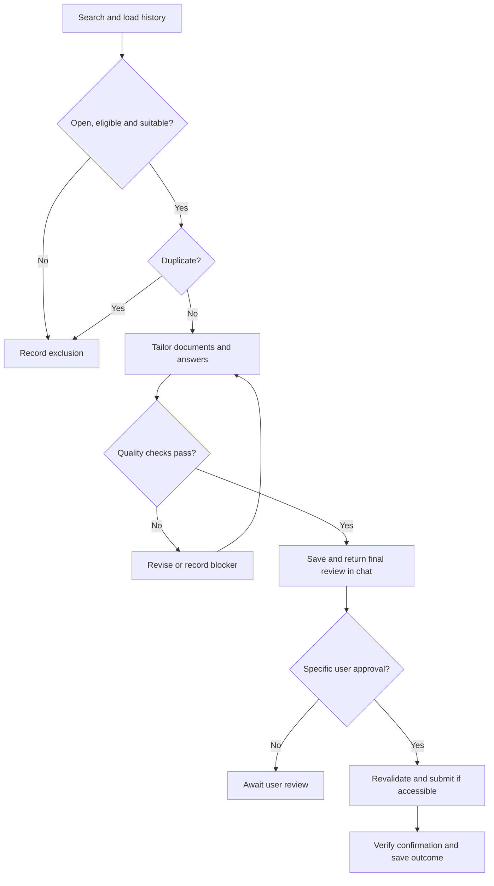

# ChatGPT Job Automation

## Overview

This project documents how I built a job-search and application workflow in ChatGPT. The system searches for relevant vacancies, assesses each role against my verified experience, prioritizes suitable opportunities, tailors my resume, reviews writing quality, and returns complete applications in chat for my approval. Submission happens only after I approve the specific reviewed application; the spreadsheet records each stage.

The workflow is designed for these target areas:

- Backend and full-stack software development
- AWS cloud engineering
- DevOps and cloud operations
- Application and technical support
- Ghana-based, hybrid, office, and globally remote opportunities

The automation prioritizes remote roles that accept applicants from Ghana. It then considers qualified Ghana-based hybrid and office roles.

> Current policy (12 October 2026): scheduled runs prepare applications only. They never send email or submit job-platform applications. Every application must pass the writing-quality review and receive my explicit approval in chat. Earlier blanket permission to submit is revoked.

## What the System Does

The automation follows this cycle:

1. Searches accessible job platforms and employer career pages.
2. Checks the job title, responsibilities, seniority, location, country eligibility, posting date, and application status.
3. Compares the vacancy with my resumes and verified professional background.
4. Calculates a recruiter-style match score.
5. Prioritizes high-fit remote roles, followed by Ghana-based hybrid and office roles.
6. Checks the tracker and submission history to prevent duplicate applications.
7. Creates a truthful, ATS-friendly resume tailored to the vacancy.
8. Reviews the complete resume, cover note and form answers against source evidence.
9. Returns eligibility, CV score, final documents and every proposed answer in chat.
10. Saves the application as **Awaiting user review**, or **Prepared / Blocked**.
11. Reports preparation results after each scheduled run; scheduled submissions are always zero.
12. After my specific approval in a subsequent interaction, rechecks duplicates and the vacancy, submits through available tools, verifies confirmation and updates the tracker.

## System Workflow



## Components

### 1. Source Resumes

I supplied three resume versions:

- General software-development resume
- Cloud Engineer resume
- DevOps resume

ChatGPT reviewed the resumes to identify my strongest job families, supported skills, measurable achievements, experience gaps, and inconsistent claims.

### 2. Master Resume

The resumes were consolidated into a two-page master template. It uses achievement-focused bullets based on the Google XYZ structure:

> Accomplished **X**, as measured by **Y**, by doing **Z**.

Only supported facts and metrics are used. Unsupported claims about uptime, scale, performance improvements, Kubernetes experience, or years of cloud experience are not added.

The master resume contains interchangeable content for:

- Backend and full-stack roles
- AWS cloud roles
- DevOps and infrastructure roles
- IT, application, and technical-support roles

### 3. Target Job Titles and ATS Keywords

ChatGPT identified relevant titles from my experience, including:

- Backend Developer
- Node.js Developer
- Full Stack Developer
- PHP/Laravel Developer
- Software Engineer
- API Developer or Integration Engineer
- Web Application Developer
- Junior AWS Cloud Engineer
- Junior DevOps Engineer
- Cloud Support Engineer
- Application Support Engineer
- Cloud Operations Engineer
- AWS Serverless Developer
- Infrastructure Automation Engineer
- IT Support Engineer
- Junior Linux Systems Administrator
- React/Next.js Developer

For every application, the vacancy's exact terminology is compared with verified skills from my resume. Keywords are included naturally and only when they describe work I have actually performed.

### 4. Application Tracker

The spreadsheet is the source of truth for application history and duplicate prevention. Recommended columns are:

| Column | Purpose |
|---|---|
| Date found | When the vacancy was discovered |
| Company | Employer or recruiter name |
| Job title | Exact advertised title |
| Canonical job URL | Original vacancy or employer link |
| Application URL/email | Actual submission destination |
| Location | Country, city, remote, hybrid, or office |
| Ghana eligibility | Confirmed, uncertain, or ineligible |
| Work arrangement | Remote, hybrid, or on-site |
| Posting date | Exact date or the platform's date evidence |
| Match score | Recruiter-style fit score out of 100 |
| Matched requirements | Evidence supporting the score |
| Missing requirements | Genuine gaps or seniority concerns |
| Tailored resume | Filename or link to the resume used |
| Status | Current application state |
| Application ID | Stable ID used for review and approval |
| Quality review | Passed, needs revision, or blocked; review date and evidence references |
| Final application text | Link/version of exact email or complete form-answer draft |
| Resume version | Exact reviewed or submitted resume version |
| User approval | Approval timestamp and reference to the specific application/version |
| Submitted at | Confirmed submission timestamp |
| Confirmation ID | Email message ID, form receipt, or other evidence |
| Duplicate key | Normalized company + title + canonical URL |
| Blocker | Missing answer, verification, login, broken form, etc. |
| Next action | Follow-up, interview, retry prohibition, or user input |
| Notes | Delivery failures, reposts, uncertainty, and corrections |

Recommended status values:

- Discovered
- Assessed
- Qualified
- Tailored
- Awaiting user review
- Approved — pending submission
- Prepared / Blocked
- Submission Uncertain
- Applied
- Delivery Failed
- Interview
- Rejected
- Withdrawn
- Closed
- Skipped — Duplicate
- Skipped — Ineligible
- Skipped — Low Fit

## Match-Scoring Method

The score is a recruiter-style assessment, not a guaranteed ATS score or probability of being hired.

| Category | Suggested weight |
|---|---:|
| Core technical requirements | 35 |
| Relevant professional experience | 20 |
| Responsibilities and project evidence | 15 |
| Seniority alignment | 10 |
| Location and work authorization | 10 |
| Education and certifications | 5 |
| Supporting skills and communication | 5 |
| **Total** | **100** |

Suggested interpretation:

- **85–100:** strong match; prioritize
- **75–84:** good match; apply if core requirements and eligibility align
- **65–74:** stretch; apply selectively when major gaps are learnable
- **Below 65:** normally skip unless there is a specific strategic reason

Location eligibility is evaluated separately from technical fit. A technically strong role can still be excluded if it clearly restricts applicants to another country.

## Job-Prioritization Rules

Prepare applications for review in this order:

1. High-fit remote roles explicitly open to Ghana, Africa, EMEA, worldwide, or Sub-Saharan Africa.
2. High-fit remote roles whose Ghana eligibility is uncertain but not explicitly prohibited.
3. High-fit Ghana-based hybrid roles.
4. High-fit Ghana-based office roles.
5. Selective stretch roles when most core requirements are supported.

Skip roles that are:

- Closed or expired
- Clearly restricted to an ineligible country
- Far above my supported seniority
- Dominated by essential skills I do not possess
- Unverifiable or suspicious
- Already submitted under another listing or repost

## Duplicate-Prevention Strategy

Before applying, the system checks:

1. The spreadsheet for the same company, title, URL, or duplicate key.
2. Previous confirmation IDs and submission timestamps.
3. Sent email history for the employer, recipient, title, and attachment.
4. Known reposts or mirrored listings that point to the same original role.
5. Applications submitted outside the automation that have been added to the tracker.

A useful duplicate key is:

```text
normalized_company | normalized_job_title | canonical_job_url
```

If submission status is uncertain, the system must not retry automatically. It records **Submission Uncertain** and waits for confirmation to prevent double-applying.

## Resume-Tailoring Process

For each qualified role, ChatGPT should:

1. Extract the employer's core requirements and repeated keywords.
2. Select the most relevant master-resume summary.
3. Reorder skills so the verified requirements appear first.
4. Select the most relevant experience and project bullets.
5. Rewrite bullets for relevance while preserving their factual meaning.
6. Add exact ATS terminology only when supported by my experience.
7. Remove unrelated content to keep the resume focused.
8. Keep the result ATS-friendly, normally one or two pages.
9. Check spelling, dates, contact details, headings, and layout.
10. Save the tailored resume with a traceable filename.

Example filename:

```text
Richard-Vidzrakou-Company-Job-Title-Resume.pdf
```

The automation must never invent technologies, employers, job duties, certifications, education, metrics, or years of experience.

## Safeguards Against AI Drivel

These are mandatory instructions in the automation, not a guarantee that AI text is error-free. The final human review remains necessary. A high CV score measures job fit; it does not prove writing quality, eligibility or successful submission.

### Mandatory Writing-Quality Gate

Review the complete tailored resume, cover note, email and all form answers before returning a ready application and again before an approved submission.

| Check | Required standard |
|---|---|
| Truthfulness | Support every skill, achievement, date, qualification, project and metric with the current CV, master resume or a user-confirmed example. Never invent or exaggerate. |
| Specificity | Connect two or three actual job requirements to concrete, relevant experience. |
| Natural wording | Use concise, plain language I can comfortably explain in an interview. |
| Relevance | Remove unrelated experience, generic praise, filler, buzzwords and exaggerated enthusiasm. |
| ATS terminology | Use supported terms naturally; avoid keyword stuffing and copying job-description language. |
| Consistency | Keep titles, dates, contact details and experience levels consistent across all materials. |
| Employer instructions | Answer the exact question and respect word limits. Flag personal/non-AI-written answers for me. |
| Auditability | Save the exact final text, resume version, evidence references and review outcome in or linked from the tracker. |

Rewrite any material that fails these checks. If missing evidence or my personal judgment prevents completion, record a blocker. Never fill a quota with weak or misleading applications; prepare fewer and report the shortfall.

**Weak wording:** “I am passionate about leveraging cutting-edge technologies to deliver innovative solutions.”

**Concrete wording, when supported by my source evidence:** “I built and deployed an education platform with a central API, separate admin and student portals, Docker containers and Paystack payments.”

Do not invent numbers to force an XYZ bullet. A factual description without a metric is better than an unsupported achievement.

### Mandatory Human Approval Gate

Every scheduled run stops at preparation. It must return a final review in chat containing:

- Stable application ID, employer, exact role and official vacancy/application link.
- Work arrangement, location, Ghana eligibility and country, residence, work-authorization and timezone constraints, with source evidence and uncertainty.
- CV match score out of 100, matched requirements and genuine gaps.
- Exact tailored CV link and version.
- For email: exact recipient, subject, complete body and attachments.
- For a platform: every question, proposed answer, selected option, attachment and relevant declaration.
- Which fields are drafts versus actually filled, unanswered mandatory questions and blockers.

Record **Awaiting user review**, not Applied. Prepare drafts locally if entering a platform would transmit or autosave application data before approval. Never claim a form has been filled unless it actually has.

After reviewing, I can reply **Apply APP-123**, using the application's actual ID, or approve an explicitly named batch. Approval covers the specific role, destination and reviewed documents/answers. Material changes require another review. Silence, notifications and earlier blanket permission do not authorize submission.

A custom clickable Apply button is not guaranteed. The official job link is for reference; clicking it is not approval for ChatGPT to submit. Submission after approval depends on available tools, account access and platform requirements.

### Copy-Ready Safeguard Instruction

```text
Scheduled runs research and prepare applications only. Never send an application
email or submit a job-platform form without my explicit approval of the final
reviewed application in chat. Previous blanket submission permission is revoked.

Review all resumes, emails and form answers against verified source evidence.
Remove unsupported claims, invented metrics, generic filler, copied JD wording,
keyword stuffing and exaggerated enthusiasm. Use concrete relevant examples
and plain language I can defend in an interview. Follow exact questions and
word limits. Flag answers requiring my judgment or personal/non-AI writing.

Return eligibility evidence and uncertainty, CV score and gaps, the exact CV
version, and the complete email or question-by-question form draft. Save the
quality review, evidence references and exact final materials in the tracker
with status Awaiting user review. Wait for approval of a specific application
ID. Revalidate eligibility, vacancy and duplicate history before an approved
submission; mark Applied only after verified confirmation. Quality overrides
quotas. If review, evidence or durable tracking is incomplete, record a blocker.
```

## Application and Verification Process

### Email Applications

Before sending, only after my specific approval:

- Verify the recipient using the official vacancy or employer website.
- Search sent mail for an existing application.
- Use a role-specific subject and concise cover note.
- Show the complete email and exact resume in chat before requesting approval.
- Attach the approved tailored resume.
- Check that the attachment filename matches the intended role.

After sending:

- Confirm the message appears in Sent.
- Save the message or confirmation ID and timestamp.
- Monitor later delivery-failure or bounce messages.
- Correct the tracker if an email initially marked Applied later fails delivery.

### Application Forms

Before submission, only after my specific approval:

- Confirm the form belongs to the employer or authorized platform.
- Draft only answers supported by known information and return every question/answer in chat.
- Fill platform fields only when authorized; use local drafts if the site transmits or autosaves data.
- Review uploaded files and answers.
- Stop when a mandatory answer requires a personal preference or unknown fact.

After submission:

- Capture the confirmation page, receipt, reference, or email.
- Mark **Applied** only when confirmation exists.
- Record validation errors as **Prepared / Blocked**.

## Conditions That Require My Input

The automation must pause instead of guessing when an application requests:

- Salary expectation not already approved
- Notice period or exact availability
- Willingness to relocate or join a residential environment
- Work-authorization declarations
- Demographic or voluntary self-identification answers
- Account creation, password, OTP, CAPTCHA, or identity verification
- Legal attestations or electronic signatures
- Assessments, recorded responses, or interviews
- Portfolio or public resume links that have not been supplied
- Questions requiring a new personal story or unsupported claim

## How to Set It Up in ChatGPT

### Prerequisites

Prepare the following:

- Current general resume
- Cloud or DevOps resume variants, if applicable
- Correct contact details and location
- Target job titles
- Preferred locations and work arrangements
- Salary range, notice period, and relocation preference
- Professional links such as LinkedIn, GitHub, and portfolio
- A spreadsheet for tracking applications
- Connected email or browser access, where available and authorized

### Step 1: Create a Dedicated ChatGPT Project

Create a project named **ChatGPT Job Automation**. Keep all job-search conversations, resumes, tailored documents, prompts, and the tracker inside this project so the system has consistent context.

### Step 2: Add Project Instructions

Use instructions similar to these:

```text
Act as my job-search and application assistant. Scheduled runs prepare only.
Return the final eligibility assessment, score, CV and complete email/form
answers in chat. Never send or submit until I explicitly approve the specific
reviewed application ID. Apply the mandatory writing-quality gate documented
in this README; record evidence, exact versions and Awaiting user review status.

Use only truthful information from my resumes and confirmed profile. Prioritize
high-fit remote jobs that accept applicants from Ghana, followed by Ghana-based
hybrid and office roles. Assess the job description before applying, calculate
a recruiter-style match score, tailor my resume to supported requirements, and
never invent experience or metrics.

Before every application, check the application tracker and submission history
for duplicates. Treat reposts and mirrored listings as the same job when they
refer to the same employer and vacancy. If submission status is uncertain, do
not retry automatically.

Mark a role Applied only after obtaining confirmation. Record delivery failure,
blocked forms, uncertain eligibility, missing answers, assessments, interviews,
and any action I must take. Stop and ask me when a required field needs a
personal decision, login verification, OTP, CAPTCHA, legal attestation, salary
expectation, relocation preference, or unsupported information.
```

### Step 3: Upload and Review the Resumes

Upload all current resume versions and ask ChatGPT to:

1. Identify the strongest job families.
2. List suitable job titles and ATS terms.
3. Detect inconsistent dates, experience totals, repeated headings, weak bullets, and unsupported claims.
4. Create a master resume using evidence-based XYZ bullets.
5. Produce focused resume sections for the main role families.

### Step 4: Create the Tracker

Ask ChatGPT to create a spreadsheet using the columns and statuses defined above. Save one authoritative tracker and make every scheduled run update that same file or connected sheet.

If the tracker is only a downloadable file in ChatGPT, it is not automatically synchronized with Google Drive or Google Sheets. To maintain a live Google Sheet, explicitly create or import the tracker in Google Sheets and instruct the automation to update that connected sheet.

### Step 5: Run a Manual Pilot

Before scheduling anything, test the workflow manually with a small batch:

1. Search for recent roles.
2. Review the match scores.
3. Inspect one tailored resume.
4. Approve one application.
5. Confirm the submission.
6. Verify that the tracker was updated correctly.
7. Test duplicate detection by presenting the same vacancy again.

The pilot reveals missing profile information, inaccessible platforms, weak search criteria, form blockers, and tracker problems before recurring runs begin.

### Step 6: Create the Scheduled Task

In a ChatGPT conversation that supports scheduled tasks, use a prompt like:

```text
Create a recurring task named "Apply to high-fit jobs" that runs every five
hours in the Africa/Accra timezone.

On each run, search accessible employer sites and job platforms for recent
Backend Developer, Node.js Developer, Full Stack Developer, PHP/Laravel
Developer, Software Engineer, API Developer, Junior AWS Cloud Engineer, Junior
DevOps Engineer, Cloud Support Engineer, Application Support Engineer, Cloud
Operations Engineer, and IT Support Engineer roles.

Prioritize remote roles that explicitly accept applicants from Ghana, Africa,
EMEA, worldwide, or Sub-Saharan Africa. Then consider uncertain remote
eligibility, followed by qualified Ghana hybrid and office roles.

Load the latest application tracker before taking action. Check company, title,
canonical URL, sent email, confirmation IDs, and known reposts so the same role
is never submitted twice. Do not retry a submission whose status is uncertain.

Assess each role, record its match score and gaps, and prepare only when the fit
is strong enough and the listing is open. Target 5–10 quality preparations per
run; do not pad the target. Tailor the resume truthfully. Never
invent skills, metrics, dates, or answers. Pause when personal input, login,
OTP, CAPTCHA, legal agreement, assessment, interview, salary, availability,
relocation, or work-authorization information is required.

Apply the mandatory writing-quality gate: verify every claim, remove generic
filler and exaggeration, use concrete examples and natural wording, check
consistency and follow employer instructions. Flag personal/non-AI answers.

Do not send emails or submit forms during scheduled runs. Return final reviews
in chat with stable IDs, eligibility evidence, CV score/gaps, exact resume
versions, complete email drafts or all form questions/answers, and blockers.
Save final materials and quality-review evidence. Mark Awaiting user review.
Wait for my explicit approval of the reviewed application ID before any later
interactive submission. A custom Apply button is not guaranteed.

After approval, revalidate the vacancy and duplicate history before submitting.
Mark Applied only after verifiable confirmation. Record failed delivery,
blocked forms, uncertain submissions, exclusions and required next actions.
Update the authoritative spreadsheet after each run and report prepared,
awaiting-review, blocked, skipped and interview-stage roles. Scheduled runs
must submit zero applications. Quality takes priority over quantity.
```

### Step 7: Verify the Schedule

After creating the task:

- Confirm its name, timezone, recurrence, and next run time.
- Ensure ChatGPT task notifications are enabled.
- Check the task after its first run.
- Review whether the spreadsheet actually changed.
- If no notification arrives, inspect whether the task is paused, failed, or stopped.

Do not assume a schedule is functioning merely because it was created successfully.

### Step 8: Supervise and Improve

Review the system regularly:

- Reconcile bounced emails and unsuccessful submissions.
- Add applications made manually or on other platforms.
- Update interview and rejection statuses.
- Refine the minimum score and job-title list.
- Remove titles producing mostly senior or ineligible results.
- Add new verified skills and projects to the master resume.
- Check that each tailored resume remains accurate.
- Archive closed vacancies without deleting their submission history.

## Recommended Run Summary

Each run should report:

```text
Run date/time:
Roles reviewed:
Scheduled submissions: 0
Prepared / awaiting user review:
Quality-review outcomes:
Prepared/blocked:
Skipped as duplicates:
Skipped as ineligible:
Delivery failures:
Interviews or assessments found:
Preparation target shortfall:
Tracker updated:
Actions required from me:
```

## Lessons Learned from This Implementation

1. **A sent email is not always a delivered application.** Later bounce messages must update the tracker.
2. **Duplicate checks must include sent mail.** Spreadsheet-only checks can miss submissions made outside the current run.
3. **Uncertain submission must not be retried automatically.** This prevents accidental duplicate applications.
4. **A recent date on a job mirror may be misleading.** Validate the employer's original listing.
5. **High technical fit does not guarantee eligibility.** Country, work authorization, and remote-region restrictions must be evaluated.
6. **Automation cannot truthfully answer every form question.** Personal preferences and legal declarations require the applicant.
7. **The tracker must have one authoritative location.** Downloaded copies easily become inconsistent, and a ChatGPT file does not automatically sync to Google Sheets.
8. **Application quantity should not override quality.** A shortfall is better than submitting weak, false, duplicate, or ineligible applications.
9. **Notifications prove reporting, not necessarily successful applications.** Every result still needs confirmation evidence.
10. **Human review remains essential.** Interviews, assessments, salary decisions, and final profile updates require the applicant.

## Privacy, Accuracy, and Platform Compliance

- Share only the personal information required for the application.
- Do not store passwords, OTPs, recovery codes, or sensitive identity documents in prompts or spreadsheets.
- Use official employer pages and verified recipient addresses where possible.
- Follow each platform's terms and avoid bypassing access controls.
- Never misrepresent skills, location, work authorization, education, employment, or experience.
- Keep confirmation evidence but avoid recording unnecessary sensitive data.
- Review all high-impact applications and personal declarations.

## Maintenance Checklist

### Weekly

- Review new applications and blockers.
- Check interview invitations and deadlines.
- Reconcile email bounces and delivery failures.
- Confirm the scheduled task is still active.
- Remove expired vacancies from the active queue.

### Monthly

- Update the master resume with verified achievements.
- Reassess target job titles and keywords.
- Review match-score accuracy against interview results.
- Clean duplicate or stale tracker entries without deleting history.
- Export or back up the authoritative tracker.

## Final Result

The completed system is a supervised job-application pipeline that combines:

- Resume analysis
- Targeted job discovery
- Eligibility validation
- Evidence-based match scoring
- ATS-aware resume tailoring
- Duplicate prevention
- Mandatory writing-quality and source-evidence review
- Explicit approval of each final application
- Controlled submission after approval
- Confirmation and delivery tracking
- Spreadsheet-based application management
- Scheduled reporting and follow-up

The system finds and prepares relevant, evidence-based applications, gives me the final review, and submits only after my specific approval. It keeps a traceable record of quality checks, decisions and confirmed outcomes.
